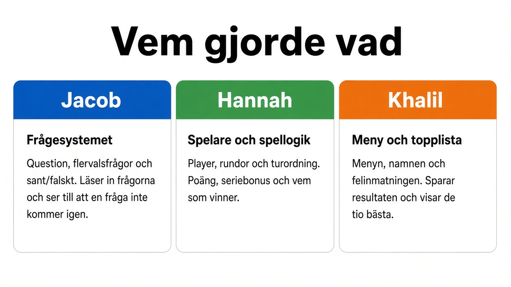

# Diamond Fighters: Quiz Battle

<p align="center">
  
</p>

Två till fyra personer spelar frågesport på samma dator. Man väljer kategori, svarar på frågor och samlar poäng. Efter matchen sparas resultatet på en topplista.

## Starta spelet

Du behöver .NET 10. Stå i den här mappen och kör:

```text
dotnet run --project Diamond_Fighters-Quiz_Battle


```
## Vem gjorde vad

<p align="center">
  
</p>

Jacob byggde frågesystemet. Hannah byggde spelarna och spellogiken. Khalil byggde menyn och topplistan.
